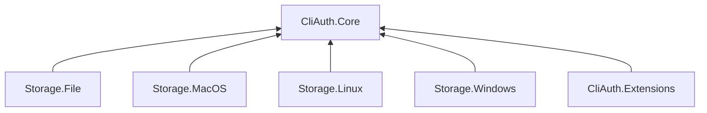

# Architecture

Bijecta.CliAuth is a library for developers adding browser and device authentication
to their own .NET CLIs. Applications configure their own OAuth 2.0/OIDC provider and
own the command framework, user interaction, and presentation.

**Current state:** immutable Core contracts, memory storage/locks, session
coordination, lazy discovery, browser PKCE, device polling, strict loopback reception, and ID-token
validation are implemented. Browser/protocol tests use signed synthetic tokens and
real local sockets, including the public constructor's real HTTP backchannel.
Ten Keycloak/Playwright integration tests and a user-run sample browser happy path
have passed. Native launcher/process checks remain pending. Refresh, remote revocation, persistent
backends, HTTP, and DI integration remain future work. See the
[browser walkthrough](docs/usage/browser-login.md). Responsibilities below include
that planned work.

## Package boundaries

Arrows show project dependencies. Each integration depends on Core; platform
storage packages do not depend on one another.

| Package | Responsibility |
|---|---|
| `Bijecta.CliAuth.Core` | Configuration, browser/device flow orchestration, internal protocol adapters, session coordination, refresh, public contracts, memory storage |
| `Bijecta.CliAuth.Storage.File` | Compact JSON reads/staged replacement; locks/logout and full integration pending |
| `Bijecta.CliAuth.Storage.MacOS` | Future macOS protected storage; mechanism deferred |
| `Bijecta.CliAuth.Storage.Linux` | Future Linux protected storage; mechanism deferred |
| `Bijecta.CliAuth.Storage.Windows` | Future Windows protected storage; mechanism deferred |
| `Bijecta.CliAuth.Extensions` | Optional DI registration and authenticated HTTP integration |

The next storage milestone is an explicitly selected plaintext file backend with
atomic replacement, cross-process coordination, and durable logout tracking. Its
package now exposes FileTokenStore reads and same-directory staged replacement using compact JSON.
Matching locks, logout, the plaintext policy value, and ITokenStore
integration are not implemented yet. See [the format](docs/usage/session-file-format.md).
[ADR 0005](docs/decisions/0005-plaintext-persistence-first.md) defers protected storage
and reopens the choice between native credential storage and encrypted files.

The application explicitly selects a storage implementation. Core and Extensions
neither reference nor automatically select platform storage packages. A macOS-only
consumer can reference Storage.MacOS without bringing in the other backends.

`src/Shared.Storage` contains internal source compiled into each storage assembly.
It is not another public package. Platform dependencies belong only to their
respective backend projects. Storage implementations must share a consistent
atomicity and coordination contract; a custom implementation must satisfy it too.

## Ownership and extension points

Maintained protocol libraries handle supported protocol operations and validation
behind internal adapters. Core owns application-facing orchestration and session
policy. Neither third-party protocol types nor a replaceable protocol engine are
part of the initial public API.

Consumers configure issuer, client ID, scopes, selected flow, and supported policy
options. They can supply storage, a browser launcher, and device-code presentation.
These extension points adapt the host application without bypassing required
protocol validation. Exact API signatures remain subject to implementation review.
The selected protocol dependencies are Duende.IdentityModel.OidcClient 7.1.1,
Duende.IdentityModel 8.1.0, and Microsoft IdentityModel components 8.23.0. These
dependencies stay internal to Core. Browser authorization preparation and code
exchange use Duende helpers; Microsoft validates the mandatory ID token. Core owns
explicit nonce, discovery policy, deadlines, bounded transport, callback checks,
conservative expiry, and scope containment. Device polling uses Duende endpoint helpers
and the shared LoginTokenValidator with device-appropriate nonce policy. The coordinator's
protocol interface and deterministic test fake stay internal.

## Authenticator composition

The authenticator supports multiple named profiles sharing one explicitly
selected token store and its matching lock provider. Profile names are ordinal and
case-sensitive; duplicate names and incompatible persistence policies fail local
configuration. Session keys isolate the profiles within that store.

Direct construction uses CliAuthenticator with profiles, a store, optional matching
locks, optional browser/clock, and a bounded lock timeout. ITokenStore.PersistenceMode
is a read-only, I/O-free declaration checked against every profile. A store exposing
its own lock provider supplies the canonical locks; a conflicting provider is rejected.
Other custom stores require an explicit matching provider. DI convenience comes later.
There is no per-profile backend routing. Instances sharing a store must share its
coordination domain. See
[ADR 0004](docs/decisions/0004-authenticator-storage-and-profile-scope.md).

## Initialization and login

Configuration is validated locally when constructed or registered. Constructors
and DI registration perform no provider requests. Discovery happens lazily when an
operation needs provider communication.

For either login flow, Core checks the selected provider capability before starting
the interactive transaction. Discovery cannot guarantee that client or user policy
will permit the request; request-time rejection remains a distinct failure. Missing
optional metadata is interpreted according to the relevant standard, rather than
treated as proof of missing support. Flows never switch automatically.

- Browser login launches the system browser and receives an authorization-code
  response on a temporary loopback listener, using PKCE.
- Device login delivers the verification URI and user code to the application's
  presentation callback, then polls according to the protocol. The device code
  remains internal; this flow needs no loopback listener or automatic browser launch.

Both flows validate the result and commit through the same session coordinator
and selected store. The implemented coordinator captures an epoch under the lock,
releases it for protocol interaction, then reloads/checks the epoch before an atomic
commit. Its fake tests verify that logout and a winning login supersede older logins.
Only explicit login initiates interactive authentication. Both flows are implemented;
missing selected-flow capabilities return UnsupportedCapability without fallback.

## Sessions, storage, and HTTP

The session coordinator owns silent cached-token acquisition, expiry decisions,
and login/logout concurrency. Refresh coordination is the next lifecycle feature;
a refresh-required acquisition currently returns UnsupportedCapability without
clearing the session or starting interaction. Persistent stores must support atomic updates and
coordination between cooperating local processes. Memory storage is explicitly
selected and process-local. Plaintext persistence must be deliberately selected;
it is never a fallback from a failed protected store. Restrictive permissions do
not provide at-rest encryption. Protection, key lifecycle, and optional platform
user verification remain later design decisions.

Status and ordinary local logout require no provider communication. A usable cached
token can be returned without discovery. Refresh and explicitly requested remote
revocation will need the provider, but do not initiate interactive login. Logout
commits deletion before optional revocation, releases the lease for remote work,
and reports its outcome separately. The fake-tested revocation path has a 30-second
cancellable deadline; the default public adapter currently reports Unsupported.

HTTP integration acquires tokens silently and attaches them only to configured
destinations. It does not automatically follow redirects or replay requests. The
application owns command output, exit codes, and any explicit retries. Credentials
and protocol secrets must be excluded from normal diagnostics.

## Samples and verification

System.CommandLine belongs to the sample CLI, not Core. The Keycloak fixture provides
browser and device clients; a user-run browser login/acquire/status/logout smoke test passed.
A separate integration test solution uses test-only Testcontainers and Playwright
dependencies to start disposable Keycloak and exercise the public authenticator.
Its ten tests cover browser/device login, cached acquisition, local logout, SSO reuse,
consent acceptance/denial, cancellation, callback port collision, and disabled device
grants. They passed locally; the latest hosted Linux CI status is not confirmed. The three-OS solution
keeps the deterministic tests free of container/browser prerequisites. The existing
ISystemBrowser extension supplies the Playwright launcher, so native desktop
launchers still need separate checks.
The sample accepts `demo --flow device`; see [device login](docs/usage/device-login.md). Provider support is
claimed only after testing; an optional single protected API may demonstrate HTTP
integration. Workers and token exchange are outside scope.

Current automated checks verify package boundaries plus local configuration,
isolation, redaction, expiry, process-local memory-store/lock behavior, and coordinator
composition, login/logout races, and fault handling through fakes. Browser tests also
exercise signed-token rejection, lazy discovery/cache, PKCE binding, callback abuse,
concurrency limits, cancellation, deadlines, and bounded transport. The integration
suite additionally exercises real Keycloak and Chromium. Native-storage, HTTP
integration, and cross-process tests remain future work; compiling a backend
project does not establish OS support.

## Decision records

This file describes the current architecture and is updated as it evolves. ADRs
record the reasons and tradeoffs behind individual decisions:

- [0001: Keep protocol integration internal](docs/decisions/0001-protocol-ownership-and-extension-boundaries.md)
- [0002: Initialize provider capabilities lazily](docs/decisions/0002-lazy-initialization-and-flow-capabilities.md)
- [0003: Protocol dependency selection](docs/decisions/0003-protocol-dependency-selection.md), supported by [runnable spikes](spikes/README.md)
- [0004: Authenticator storage and profile scope](docs/decisions/0004-authenticator-storage-and-profile-scope.md)
- [0005: Plaintext persistence first](docs/decisions/0005-plaintext-persistence-first.md)
